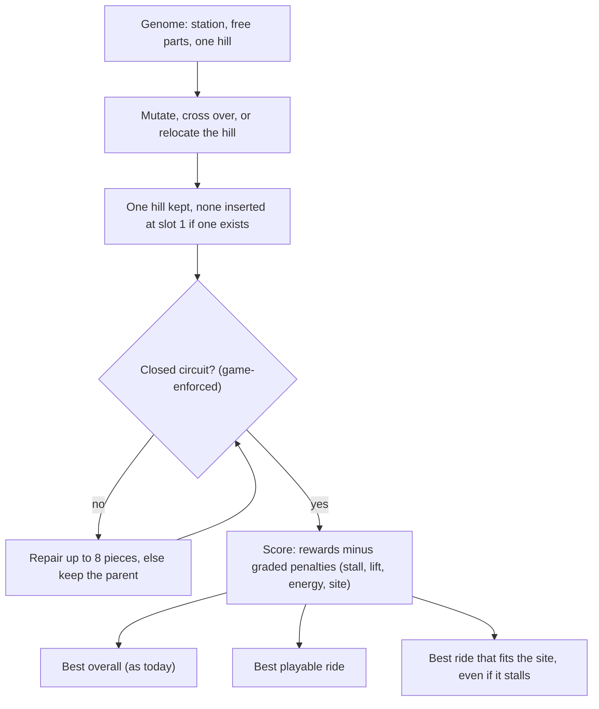

# Free Ride Layout Search - Plan

## Goal Capsule

- **Objective:** On a tight site, the generator finds rides that fit the space instead of breaking out of it, because it can build the layouts a human builder would try, such as a turn before the lift hill.
- **Means:** The lift hill stays a required part of every ride but may sit anywhere after the station, and the rules that fixed its place become score penalties wherever the game does not enforce them (see Key Decisions).
- **Authority:** Product Contract requirements win on behavior. Key Decisions record who chose what and why. Planning decides mechanism.
- **Open blockers:** None for planning. The train-length check (R10) must finish before any physics work on train length or the push out of the station.
- **Stop conditions:** Stop and report if no-site median excitement cannot be held at the bar in R8 after tuning, and apply the site-only fallback (KTD6) instead of shipping a quality drop. Stop if the baseline numbers (U1) do not exist before the genome change (U3) starts.
- **Execution profile:** `ce-work`, three PRs in the order under Phased Delivery. Every genome change is measured on the site benchmark and the no-site benchmark against a baseline recorded first. U2 needs the owner's machine and the game, so the owner runs it. The exported ride file format does not change.

---

## Product Contract

### Summary

The part-based search keeps one lift hill in every ride but stops pinning it to the slot right after the station. The lift rule is worked out from the finished track, and only what the game itself enforces stays a hard rule, so odd layouts can survive long enough to improve. A run returns the best playable ride and the best ride that fits the site, even if its train stalls. A small check in the game decides whether train length can become part of the design.

### Problem Frame

Using the site feature on a 14 by 14 test site, the generator let the ride break out of the space. It never tried layouts like station, curve, short lift, curve. The cause is in how rides are built: the part-based genome pins the station at part 0 and one lift hill at part 1, and mutation and crossover only work from part 2 on, so nothing can ever sit between the station and the hill (`rct2/mutations.py`, `HILL_INDEX`, `FIRST_FREE_INDEX`). The hill is a straight climb and drop of at least 10 tiles, so the station plus the smallest hill is one straight run 16 tiles long. No ride with the hill right after the station fits a space 14 tiles across in any heading.

This is a shortcut in the search, not a rule of the game. A hand-built `station, turn, hill` track passes generide's construction and physics checks, and the train completes with the lift landing on the hill. The pin was also earned: making the hill a mandatory part took median excitement from 1.87 to 4.33 and the share of runs clearing the drop-height threshold from 3 of 25 to 25 of 25 (`docs/research-plan.md`). A crude experiment that only freed the hill's position raised the blocked-centre site's fit rate from 40% to 100% on 5 seeds, but halved no-site median excitement from 4.24 to 2.14. The fix has to keep the hill mandatory and protect ride quality.

### Key Decisions

- **Free layout over footprint-first search, site seeding, and diversity search** (session-settled: user-directed, chosen over a footprint-first search, seeding from hand-made site layouts, and keeping odd layouts alive: closest to today's method and measurable on the existing site benchmark). Governs R1, R2, R3, R4.
- **Only game-enforced rules stay hard** (session-settled: user-directed, chosen over keeping every validity check hard, or checking only finished rides: lets odd layouts survive as stepping stones; the finished ride is still checked). Governs R5, R6.
- **A run returns both the best playable ride and the best fitting ride** (session-settled: user-directed, chosen over never returning a stalled ride and over returning only one). Governs R7.
- **Check train length in the game before deciding its role** (session-settled: user-directed, chosen over making it a search variable, a user setting, or leaving it out). Governs R10.
- **Keep one mandatory hill, free its position, and guard no-site quality** (session-settled: user-approved, proposed after an independent review found the free hill halves no-site quality; the user confirmed the revised scope). Governs R2, R8.

### Requirements

**Layout freedom**

- R1. The search can place a turn or other pieces between the station and the lift hill; the station stays first on the track.
- R2. Every ride the search builds has exactly one lift hill that clears the game's drop-height threshold, wherever it sits after the station.
- R3. The chain lift goes where the game would put it, on the first uphill run of the finished track, so a climb ahead of the hill that would take the lift away from it is scored as a failure to power the hill and is never accepted silently.
- R4. Each run's starting population includes layouts with the hill in different places, including after a turn, produced by the search's own moves and not by hand-made starting layouts.

**Rules and scoring**

- R5. A ride must be buildable in the game and be a closed circuit; every other failure, including a stalled train and a missing qualifying drop, is a score penalty and not a rejection.
- R6. Penalties are capped against the most a ride can earn, so they steer the search without making an invalid ride worth more than a valid one (`docs/solutions/performance-issues/genome-bloat-from-uncapped-fitness-rewards.md`).
- R7. A run returns two rides: the best playable ride, and the best ride that fits the site even if its train stalls. The result shows both, labels the second as not playable when its train stalls, and shows one when they are the same ride.

**Measurement and the game check**

- R8. With no site, median excitement on the standard benchmark does not fall below today's level.
- R9. On the site benchmark, the blocked-centre site's fit rate rises above today's 40%, and the L-shape and downhill sites stay at today's 100%.
- R10. Before any physics change for train length or the push out of the station, a check establishes whether train length can be set in the ride file and in the headless oracle, and whether it changes how far the train rolls out of the station. Its result decides whether train length becomes a design variable, a user setting, or stays out.

### Success Criteria

- The first check Josh would make is that small sites fit: R9 is met with the 25-seed, 2,000-evaluation protocol the earlier benchmark used, not only 5 seeds.
- Ride quality holds: R8 is met on the same protocol.
- A tight site that no pinned layout can hold, such as a 14 by 14 site, reports its fit rate but is not a pass bar. Whether any closed loop with a hill fits it is not established.

### Acceptance Examples

- AE1. **Covers R1, R3.** Given a ride with a turn between the station and the hill, when it is scored, the chain lift lands on the hill, the train completes, and the ride counts as playable.
- AE2. **Covers R3, R5.** Given a ride with a small climb before the hill that takes the chain lift, when it is scored, the hill is reported as unpowered and the ride carries a penalty, but the search can keep it as a stepping stone.
- AE3. **Covers R7.** Given a run whose best fitting ride stalls, when the run finishes, the result shows the best playable ride and the fitting ride, and labels the fitting ride as not playable.
- AE4. **Covers R8.** Given a run with no site, when the benchmark runs before and after the change, median excitement is no lower than before.

### Scope Boundaries

**Deferred for later**

- A footprint-first search that finds a ground plan before placing lifts and drops.
- Seeding runs from hand-made compact site layouts.
- A search that keeps the best ride of each layout family alive.
- A turn inside the lift hill, and more than one chain-lifted climb.
- The rule that stops the search from dipping below its start level, which blocks sites whose ground falls away; it is a separate fix.
- Station flatness, the path to the entrance, and clearance above ground in the fit check.
- Ride types other than the mine train.

### How This Work Fits Together

<!-- ce-section: work-relationships -->

This plan covers freeing the lift hill's position and the train-length check. The broader breakdown below is the current understanding, not a committed roadmap.

- Train and station physics, if the check shows train length matters
  - Depends on the train-length check in R10.
- Seeding runs from compact site-fitting layouts
  - Enables better fit on very tight sites; depends on this plan's measurements to know if it is needed.
- Footprint-first search and keeping odd layouts alive
  - Can proceed independently of this plan and sit closest to the boundary in `STRATEGY.md` about new generation methods.
- Letting the search dip below its start level
  - Can proceed independently of this plan.
- Painting a site and importing one from a saved park
  - Can proceed independently; both create the sites this plan is measured on.

### Dependencies and Assumptions

- This changes the part-based search (`ga_parts`) only.
- "Fits" means the same tile check the site feature uses today (`rct2/site.py`).
- The headless oracle cannot set train length today (`ridesetvehicle` rejects every argument shape tried, `docs/devlog.md`), so R10 may end with "cannot be set yet".
- OpenRCT2's station departure speed was not established from source; the physics model's 2.2 m/s station push (`rct2/physics.py`) is the repo's own assumption.

### Outstanding Questions

**Deferred to Planning**

- Whether any closed loop with a hill fits a 14 by 14 site, so it can be judged as a fair test. Answered by a feasibility check in U7.
- What a run exports when it finds no playable ride. Today such a run is recorded as failed with no buildable ride; the planner keeps that unless U6 shows a reason to change it.

### Sources and Research

- `rct2/mutations.py`: `HILL_INDEX`, `FIRST_FREE_INDEX`, `ensure_hill_parts`, `mutate_parts`, `crossover_parts`, `repair_circuit`, and the `_stays_above_ground` check.
- `rct2/construction.py`: `build_hill`, `find_first_hill`, `default_lift_indices`, `MIN_HILL_HEIGHT`.
- `rct2/benchmark.py`: `canned_sites` and `run_site_benchmark`, the first fit rates in `docs/devlog.md` (2026-10-10).
- `docs/research-plan.md`: the measured effect of the mandatory hill.
- `docs/solutions/performance-issues/genome-bloat-from-uncapped-fitness-rewards.md`: why penalties must be capped.
- `docs/plans/2026-10-09-0326-feat-site-aware-ride-fit-plan.md`: the site feature this builds on.
- A scratch experiment run for this brainstorm (hill free to move, 5 seeds, 800 evaluations): blocked-centre fit 40% to 100%, open 18 by 18 fit 0% to 20% with none usable, 14 by 14 fit 0% before and after, no-site median excitement 4.24 to 2.14. It was not committed and did not fix the lift rule, so treat it as directional.

---

## Planning Contract

Product Contract unchanged. Planning answered the questions it left for planning (the bars for R8 and R9, how the lift rule is applied, how crossover keeps one hill, how starting variety is produced) in the decisions below.

### Key Technical Decisions

- KTD1. **Find the hill by looking for it, not by slot.** One lookup returns the index of the part that is a built hill, and every place that assumed slot 1 (`ensure_hill_parts`, `mutate_parts`, `crossover_parts`, `_ensure_scaffold_parts`) uses it. Governs R1, R2. The slot constants stop being rules; the station staying first stays a rule.
- KTD2. **Exactly one hill, enforced where genomes are made.** After crossover and after any mutation, a second hill is dropped (the first is kept) and a missing hill is inserted at slot 1, as `ensure_hill_parts` does today. Two hills would compete for the one chain lift. Governs R2.
- KTD3. **The lift rule does not change.** The chain lift stays on the first uphill run, which `construction.find_first_hill` and `default_lift_indices` already define for physics, scoring and the exported ride (`rct2/generate.py`). A small climb separated from the hill by flat pieces takes the lift and strands the hill. Checked: station, a two-piece climb, two flats, then a 10-unit hill gives lift indices on the climb only, 30 energy violations, a stall at piece 10, and energy-shortfall issues from `validate_construction`. That is already a graded penalty, so U5 pins it with a test and adds no new rule. Governs R3. Giving every climb a lift is deferred.
- KTD4. **Variety comes from the search's own moves.** Mutation can insert before the hill, a new relocate-the-hill mutation moves it, and the random starting tracks place the hill after a random number of parts. The seed stays `create_hill_circuit()`. Governs R4. No hand-made starting layouts.
- KTD5. **Soft rules are the existing graded penalties.** A stalled train, a missing lift and energy shortfalls already cost score in `WeightedProxyFitness` (stall penalty graded by progress, missing-lift penalty, energy-violation penalty), so R5 needs no new scoring. The only hard rejections at mutation time are the closed circuit (game-enforced) and the ground check (`_stays_above_ground`), which is deferred. R6 is checked, not rebuilt: penalties must stay large enough that an invalid ride never outscores a valid equivalent (`docs/solutions/performance-issues/genome-bloat-from-uncapped-fitness-rewards.md`). Governs R5, R6.
- KTD6. **Fallback if quality cannot be held.** If no-site median excitement stays under the R8 bar after tuning (relocation rate, share of varied starting tracks, hill adjust steps), free the hill only when the run has a site, so ordinary runs behave exactly as today. This is a decision rule for U7, not a second implementation up front. Governs R8.
- KTD7. **The two rides come from observing every evaluation.** The evolution loop takes an optional predicate for "fits the site" and a playable test, and keeps the best individual that is playable and the best that fits, next to the best overall. Nothing about selection changes. Governs R7.
- KTD8. **One measurement protocol, same seeds before and after.** `ga_parts`, seeds 1 to 25, 2,000 evaluations, the three canned sites plus no site, results saved under `benchmark_results/` (not tracked) and the tables copied into `docs/devlog.md` with the code revision. Proposed bars, recorded as assumptions: no-site median excitement at least 95% of the baseline; blocked-centre fit at least 80%; L-shape and downhill no worse than baseline. Governs R8, R9.
- KTD9. **The train-length check follows the park-read spike pattern.** A probe script and a runbook for the owner, findings blank until they run it, and no search code depends on it. Governs R10.

### High-Level Technical Design

How a candidate ride moves through the search after this change. The hard gate is the only place a layout is rejected outright. Everything after it is a score.

### Assumptions

- The bars in KTD8 are proposals. The baseline in U1 may show they are too loose or too tight, and U7 reports against them.
- Five seeds were enough for the brainstorm's experiment to show direction only. The 25-seed protocol decides.
- The 14 by 14 test site is reported and is not a pass bar.

### System-Wide Impact

- **Seeded results change on purpose.** Two sets of tests pin seeded no-site runs: the seeded best-ride values in `tests/test_fitness.py` (`TestNoSiteIsUnchanged`) and the output digests in `tests/test_evolve_coaster.py`. They exist to catch accidental change and will be re-recorded in U7, after the quality guard passes, with the reason in a comment. The fixture score pins in `tests/test_fitness.py` stay as they are because scoring does not change.
- **The browser demo** runs the same search through `rct2/demo.py`, so it changes the same way. The test that pins the demo to the CLI byte for byte keeps passing because both use the same code.
- **Run records and the exported ride format** are unchanged, except that a run with a site may carry a second ride (U6). Older records load without it.
- **Docs that describe the pinned hill** (`docs/architecture.md`, `docs/research-plan.md`) are updated in U7.

### Risks and Mitigations

| Risk | Mitigation |
|---|---|
| Free hill lowers ordinary ride quality, as the 5-seed experiment showed (median excitement 4.24 to 2.14). | The baseline comes first (U1), R8 is a hard bar in U7, tuning is allowed, and KTD6 narrows the change to site runs if tuning fails. |
| The search wanders into layouts that never close or never get a lift. | The closed-circuit gate and repair stay; stall, lift and energy penalties are graded so the search can climb. U5 pins the ordering. |
| Crossover or relocation produces two hills or none. | KTD2, with tests over many seeds in U3. |
| Repair cannot close a loop after the hill moves far from the station. | U4 bounds how far the random starting tracks put the hill and measures the closure rate against today's. |
| The 14 by 14 site has no feasible layout, so a 0% fit rate means nothing. | U7 runs a feasibility check before judging it. |
| Train length cannot be set in the oracle, so R10 ends with "not yet". | Accepted in the requirement; the probe records exactly what was tried. |
| Full benchmark passes are slow. | Run in the background; U1 and U7 each need one pass, and smoke runs at 5 seeds guard the units in between. |

### Alternatives Considered

- **Keep the hill pinned but add a second pinned shape with a turn before it.** Rejected: it is another hard-coded slot, and a third shape would need a fourth.
- **Give every climb run a chain lift.** Rejected for this plan: it changes the exported ride and the lift rule together. It is deferred, and would enable "lift, curve, lift" layouts.
- **Free the hill only for site runs from the start.** Kept as the fallback in KTD6. It guarantees no change for ordinary runs but leaves the pin in place for everyone else, against the goal of fewer hard limits.

### Phased Delivery

1. **Measure and check.** U1 and U2. No search behavior changes. Output: the baseline numbers and the train-length probe with its runbook.
2. **Free the hill and guard quality.** U3, U4, U5, U7. Output: the genome change, the lift and scoring checks, and the before and after tables that decide R8 and R9.
3. **Show both rides.** U6.

---

## Implementation Units

### U1. Baseline numbers and a way to benchmark any site

- **Goal:** Record today's results at the full protocol, and make it possible to benchmark an extra site from a file so the 14 by 14 site is reported.
- **Requirements:** R8, R9; Success Criteria.
- **Dependencies:** None.
- **Files:** `run_benchmark.py`, `rct2/benchmark.py`, `tests/test_benchmark.py`, `docs/devlog.md`.
- **Approach:**
  1. Add a `--site-file` option to `run_benchmark.py` that loads a site with `Site.load` and runs it alongside the canned sites, named by its file stem, in the same summary. `canned_sites()` itself does not change.
  2. A missing or malformed file is rejected with the existing site error message before any run starts.
  3. Run the baseline on the unchanged search (commands under the Verification Contract), in the background, and copy the no-site table and the site table into `docs/devlog.md` with the code revision.
- **Execution note:** Record the baseline before U3 starts. The numbers must come from code without the genome change.
- **Patterns to follow:** The `--sites` flag and `print_site_summary` in `run_benchmark.py`; `run_site_benchmark` in `rct2/benchmark.py`.
- **Test scenarios:**
  - A site file passed with `--site-file` appears in the site summary under its file stem, next to the three canned sites.
  - A path that does not exist, and a file that is not a valid site, each stop the command with a message naming the problem, and no run starts.
  - `canned_sites()` still returns exactly `l-shape`, `blocked-centre` and `downhill`.
- **Verification:** The baseline tables are in `docs/devlog.md` with the code revision, covering no-site median and best excitement, reliability, and fit rates for the three sites and the 14 by 14 site.

### U2. Train-length check in the game

- **Goal:** Find out whether train length can be set in the ride file and in the headless oracle, and whether it changes how far a train rolls out of the station, so the owner can decide its role.
- **Requirements:** R10.
- **Dependencies:** None. The owner runs it on a machine with the game, as with `tools/park_probe.js`.
- **Files:** `tools/train_probe.js` (new), `docs/train-length-spike.md` (new).
- **Approach:**
  1. The runbook starts from what is known: the oracle reads back the train configuration the game actually gave a ride (`GENERIDE_TRAINS` in `rct2/oracle.py`), and today that is the game's default of 3 trains and 12 cars because `ridesetvehicle` rejects every argument shape tried.
  2. The probe tries, in order, the argument shapes already tried, the same actions with the ride closed (one cause to rule in or out, not a known cause), and plugin property assignment on the ride, each time reading back what the game built.
  3. It places a ride file whose `num_trains` and `cars_per_train` differ (`rct2/td6.py`) and reads back what the game built.
  4. For each configuration that works, it builds the same station, turn, hill layout and records whether the train reaches the lift and how far it rolls.
  5. The write-up has a findings table with every row set to "not run", a space for raw output, and a decision line: design variable, user setting, or leave out.
- **Execution note:** Syntax-check the probe against a stub, as `tools/park_probe.js` was. Do not claim it ran.
- **Patterns to follow:** `tools/park_probe.js`, `docs/park-read-spike.md`, `tools/oracle_probe.js`, `docs/headless-oracle-spike.md`.
- **Test scenarios:** Test expectation: none -- a throwaway probe and a write-up whose findings are blank until the owner runs it.
- **Verification:** `docs/train-length-spike.md` exists with every finding "not run" and the decision "pending". Nothing in `rct2/` depends on it.

### U3. Free the hill's position in the genome

- **Goal:** The search can place parts between the station and the hill, and can move the hill, while every genome keeps exactly one.
- **Requirements:** R1, R2; KTD1, KTD2.
- **Dependencies:** U1.
- **Files:** `rct2/mutations.py`, `rct2/evolution.py`, `tests/test_mutations.py`, `tests/test_evolution.py`.
- **Approach:**
  1. Add the hill lookup (KTD1) and use it in `ensure_hill_parts`, `mutate_parts`, `crossover_parts` and the scaffold ordering in `rct2/evolution.py`.
  2. In `mutate_parts`, allow insertion from the slot after the station, including directly before the hill. Delete, replace and swap skip the hill part. `adjust_hill` edits the hill wherever it sits. Add one mutation that moves the hill to another slot after the station.
  3. In `crossover_parts`, start cut points just after the station, then keep the first hill and drop any later one (KTD2).
  4. Keep the backstop that inserts a hill at slot 1 when a genome from elsewhere has none.
- **Execution note:** Rewrite the existing tests that assert the hill sits at `HILL_INDEX` first, so they state the new invariant (one hill after the station) and fail against the old code.
- **Patterns to follow:** `ensure_hill_parts`, the existing six mutation types, and the part-boundary rule in `crossover_parts`.
- **Test scenarios:**
  - Over many seeded mutations of the seed genome, every result has the station at part 0 and exactly one hill after it.
  - Over many seeded crossovers, both children have exactly one hill and the station at part 0.
  - Over many seeded mutations, at least one genome has a non-hill part between the station and the hill.
  - A relocate mutation changes the hill's slot, leaves the hill's pieces intact, and leaves the station first.
  - Delete, replace and swap never remove or alter the hill part, and `adjust_hill` still changes only its height.
  - A genome with no hill gets one at slot 1; a genome with two hills keeps the first.
  - `mutate_parts` still sometimes returns closed circuits (the existing test).
  - Starting from `create_hill_circuit()`, the first genome still has the hill at slot 1.
- **Verification:** The mutation and evolution tests pass, and a 5-seed smoke run of `ga_parts` completes with every individual keeping one hill.

### U4. Varied starting populations

- **Goal:** Each run starts with some layouts where the hill is not right after the station.
- **Requirements:** R4; KTD4.
- **Dependencies:** U3.
- **Files:** `rct2/mutations.py` (`generate_random_track_parts`), `rct2/evolution.py` (`_create_initial_population_parts`), `tests/test_mutations.py`, `tests/test_evolution.py`.
- **Approach:**
  1. `generate_random_track_parts` places the hill after a random number of leading parts, up to a small bound, instead of always at slot 1.
  2. Pick the bound by measuring how often those tracks close under `repair_circuit` (it adds at most 8 pieces), against today's closure rate.
  3. The mutated-from-seed share of the starting population gets its variety from U3's moves; the seed stays `create_hill_circuit()`.
- **Patterns to follow:** The comment in `generate_random_track_parts` on why the hill does not count against the length budget.
- **Test scenarios:**
  - Across many seeds, the starting population contains both layouts with the hill at slot 1 and layouts with a part between the station and the hill.
  - Random starting tracks close at no less than a rate recorded from today's generator on the same seeds.
  - Every starting individual has the station first and exactly one hill.
- **Verification:** Tests pass, and the closure-rate comparison is recorded in the devlog entry in U7.

### U5. Scoring and the lift rule hold for a moved hill

- **Goal:** A layout with a turn before the hill is exported, scored and judged correctly, and a layout whose hill loses the lift is penalized, not rejected and not rewarded.
- **Requirements:** R3, R5, R6; KTD3, KTD5.
- **Dependencies:** U3.
- **Files:** `tests/test_fitness.py`, `tests/test_construction.py`, `tests/test_generate.py`; `rct2/fitness.py` only if a test fails.
- **Approach:**
  1. Write the tests below first. They check behavior that exists today for a moved hill.
  2. Fix only what fails. If the ordering of scores is wrong, adjust the weights minimally and record why, keeping penalties large enough that an invalid ride never outscores a valid equivalent.
  3. Confirm that no new rejection was added to the search beyond the closed circuit and the deferred ground check.
- **Execution note:** Verify first and change second. The expected result is that no production change is needed.
- **Patterns to follow:** `TestSiteFitness` in `tests/test_fitness.py` for ordering tests; the export round trip tests in `tests/test_generate.py`.
- **Test scenarios:**
  - Covers AE1. A closed layout with a turn between the station and the hill: the physics trace completes, the lift indices land on the hill, `validate_construction` reports no energy shortfall, and the exported ride file marks those pieces as chain lift after a `td6.load` round trip.
  - Covers AE2. The same layout with a two-piece climb and two flats inserted before the hill: the lift lands on the climb, `validate_construction` reports energy shortfalls, the trace stalls, and the fitness is lower than the first layout's.
  - The AE2 layout still scores higher than the same layout left open, so it can serve as a stepping stone.
  - A climb directly adjacent to the hill merges with it into one lifted run (the observed behavior), pinning that case.
  - A later stall scores higher than an early stall on the same layout, so the search has a gradient.
- **Verification:** The new tests pass with no production change, or with a recorded minimal weight change and the reason.

### U6. Return both rides

- **Goal:** A run with a site returns the best playable ride and the best ride that fits the site, shows both, and labels the second when its train stalls.
- **Requirements:** R7; KTD7.
- **Dependencies:** None for the code, though it is most useful after U3 and U4.
- **Files:** `rct2/evolution.py`, `evolve_coaster.py`, `rct2/runrecord.py`, `rct2/webui.py`, `rct2/webui_static/app.js`, `rct2/webui_static/style.css`, `tests/test_evolution.py`, `tests/test_evolve_coaster.py`, `tests/test_runrecord.py`, `tests/test_webui.py`.
- **Approach:**
  1. Add one small tracker used by both evolution loops (the part-based and the piece-based). It sees every evaluated individual and keeps the best playable one (construction valid and the train completes) and the best that fits the site, next to the best overall. Selection and the best-overall result do not change.
  2. In `evolve_coaster.py`, when a site is set and the best fitting ride differs from the best playable ride, write a second ride file with a `-fits` suffix next to the first and print both rides' stats. When they are the same ride, or there is no site, nothing changes.
  3. The run record's result gains an optional fitting-ride section (the ride, whether it is playable, its file). Records without it load unchanged.
  4. The web UI result shows a second picture and a plain label ("Best fit, not playable: the train stalls") when the fitting ride is not playable, and shows one ride when they are the same.
- **Patterns to follow:** The site verdict plumbing from the site feature (`ride_summary`, `_site_verdict`, the web UI rows); the installed-ride and check sections of the web UI result.
- **Test scenarios:**
  - The tracker, fed a scripted sequence of evaluations, keeps a fitting ride that scores lower overall than a non-fitting one.
  - Covers AE3. A seeded run on a site where the best fitting ride stalls returns both rides, and the result labels the fitting ride as not playable.
  - When the best fitting ride is also the best playable ride, the result carries one ride and no second file is written.
  - With no site, the result carries one ride and no fitting section.
  - A run record from before this change loads and renders with no fitting section.
  - The web payload for a run with two rides includes both pictures and the label text.
  - The CLI writes the second ride file only when the rides differ, and its name ends in `-fits`.
- **Verification:** The tests pass, and the local web UI browser suite passes with a run that has two rides.

### U7. Re-measure, re-record, and decide

- **Goal:** Show whether the change met the bars, re-record the seeded pins on purpose, and update the docs that described the pinned hill.
- **Requirements:** R8, R9; Success Criteria; KTD6, KTD8.
- **Dependencies:** U1, U3, U4, U5.
- **Files:** `docs/devlog.md`, `docs/architecture.md`, `docs/research-plan.md`, `tests/test_fitness.py`, `tests/test_evolve_coaster.py`.
- **Approach:**
  1. Run the same protocol as U1 on the same seeds and compare against the bars in KTD8. If the no-site bar fails, tune within KTD6's list and run again; if it still fails, apply the site-only fallback and say so.
  2. Once the guard passes, re-record the seeded best-ride values and output digests, each with a comment saying the search changed on purpose and pointing at the devlog entry.
  3. Report the 14 by 14 site's fit rate and run a feasibility check for it (a throwaway script is enough): does any closed loop with a hill fit that site at all?
  4. Update the devlog with the before and after tables and the closure-rate comparison from U4, the architecture section on mutations, and a note in the research plan that the pin was relaxed, with the numbers.
- **Execution note:** Do not re-record any pin before the quality guard passes. A pin that fails is information until then.
- **Test scenarios:** Test expectation: none beyond re-recording the existing seeded pins. The fixture score pins stay unchanged and keep passing.
- **Verification:** The devlog has the before and after tables with the code revision, R8 and R9 are met or the fallback is applied and recorded, and the full test suite passes.

---

## Verification Contract

| Check | Command | Applies to |
|---|---|---|
| Full test suite | `python3 -m pytest -q` (about 2 minutes) | every unit |
| Search tests | `python3 -m pytest -q tests/test_mutations.py tests/test_evolution.py tests/test_fitness.py tests/test_construction.py tests/test_generate.py` | U3, U4, U5 |
| Benchmark tests | `python3 -m pytest -q tests/test_benchmark.py` | U1 |
| Baseline and after, no site and canned sites | `python3 run_benchmark.py --methods ga_parts --seeds 25 --evaluations 2000 --sites --output benchmark_results/<name>.json` (run in the background; a full pass is long) | U1, U7 |
| Extra site | add `--site-file <path to site.json>` to the command above | U1, U7 |
| Smoke run between units | the same command with `--seeds 5 --evaluations 800` | U3, U4 |
| Local web UI browser tests | `python3 tools/build_demo.py`, then `npx playwright test` from `demo/` | U6 |
| Train-length probe | owner runs it with the game, following `docs/train-length-spike.md` | U2 |

## Definition of Done

- Every unit's verification is met.
- The baseline and after tables are in `docs/devlog.md` with code revisions, and R8 and R9 are met or the fallback in KTD6 is applied and recorded.
- The seeded pins were re-recorded only after the quality guard passed, each with the reason.
- `docs/architecture.md` and `docs/research-plan.md` no longer describe the hill as pinned.
- `docs/train-length-spike.md` exists with findings marked "not run" until the owner runs the probe, and nothing depends on it.
- Scratch experiment code and any abandoned attempts are removed from the diff.
